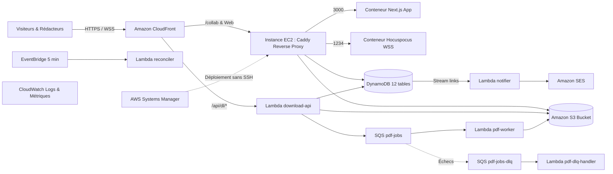

# Guide de Déploiement et d'Exploitation sur AWS

Ce guide documente la démarche d'ingénierie cloud complète pour le déploiement en production de l'**Éditeur Collaboratif**. Il expose de manière ordonnée la gouvernance des autorisations IAM, la mise en place du backend d'état distant, le moment précis où Terraform prend le contrôle exclusif de l'infrastructure, ainsi que les procédures de conteneurisation, de mise à jour sécurisée via AWS Systems Manager (SSM) et de nettoyage intégral.

---

## Sommaire

1. [Vue d'Ensemble de l'Architecture Déployée](#1-vue-densemble-de-larchitecture-déployée)
2. [Étape 0 — Gouvernance IAM et Politique de Délimitation](#2-étape-0--gouvernance-iam-et-politique-de-délimitation)
3. [Étape 1 — Création Préalable du Backend S3 Terraform](#3-étape-1--création-préalable-du-backend-s3-terraform)
4. [Étape 2 — Prise en Main par Terraform (IaC)](#4-étape-2--prise-en-main-par-terraform-iac)
5. [Étape 3 — Construction et Publication des Conteneurs (ECR)](#5-étape-3--construction-et-publication-des-conteneurs-ecr)
6. [Étape 4 — Déploiement sur EC2 sans SSH via AWS SSM](#6-étape-4--déploiement-sur-ec2-sans-ssh-via-aws-ssm)
7. [Étape 5 — Validation de Santé et Test de Fumée](#7-étape-5--validation-de-santé-et-test-de-fumée)
8. [Étape 6 — Procédure de Retour Arrière (Rollback)](#8-étape-6--procédure-de-retour-arrière-rollback)
9. [Étape 7 — Destruction Complète des Ressources](#9-étape-7--destruction-complète-des-ressources)

---

## 1. Vue d'Ensemble de l'Architecture Déployée

L'ensemble des composants applicatifs et d'infrastructure réside dans une unique région AWS : **`eu-north-1`** (Stockholm).



---

## 2. Étape 0 — Gouvernance IAM et Politique de Délimitation

Avant toute création de ressources, une politique de délimitation des autorisations (**Permissions Boundary**) doit être active sur le compte AWS.

### Rôle et Nécessité
Dans une organisation cloud ou un cadre d'évaluation normé, les rôles créés par un outil d'Infrastructure as Code ne doivent en aucun cas pouvoir s'octroyer des privilèges d'administration non autorisés. La *Permissions Boundary* définit le périmètre maximal absolu des droits que Terraform est autorisé à déléguer aux fonctions Lambda et à l'instance EC2.

### Définition de la Politique (`editeur-collab-boundary`)
Si la politique n'est pas encore présente sur votre compte AWS, créez-la via l'AWS CLI :

```bash
aws iam create-policy \
  --policy-name editeur-collab-boundary \
  --policy-document file://infra/terraform/policies/boundary-policy.json \
  --region eu-north-1
```

Récupérez l'ARN résultant (par exemple : `arn:aws:iam::106471789355:policy/editeur-collab-boundary`).

### Injection Obligatoire dans la Configuration
Renseignez cet ARN dans le fichier des variables de déploiement `infra/terraform/terraform.tfvars` :

```hcl
permissions_boundary_arn = "arn:aws:iam::<VOTRE_ACCOUNT_ID>:policy/editeur-collab-boundary"
aws_region               = "eu-north-1"
project                  = "editeur-collab"
environment              = "production"
monthly_budget_usd       = 10
alert_email              = "responsable@association.fr"
ses_sender               = "journal@association.fr"
ses_recipients           = ["responsable@association.fr"]
```

Le code Terraform applique rigoureusement cette variable sur l'ensemble des 8 rôles IAM du projet (`aws_iam_role.permissions_boundary`).

---

## 3. Étape 1 — Création Préalable du Backend S3 Terraform

Terraform doit impérativement stocker son fichier d'état (`terraform.tfstate`) dans un emplacement distant sécurisé, chiffré et partagé. Comme Terraform ne peut pas gérer lui-même le stockage dans lequel il s'écrit, le bucket de backend doit être instancié **avant** le premier appel Terraform.

### Création du Bucket d'État
1. Choisissez un nom de bucket globalement unique (ex: `editeur-tfstate-prod-<ACCOUNT_ID>`).
2. Créez le bucket dans la région cible `eu-north-1` :
   ```bash
   aws s3api create-bucket \
     --bucket editeur-tfstate-prod-$(aws sts get-caller-identity --query Account --output text) \
     --region eu-north-1 \
     --create-bucket-configuration LocationConstraint=eu-north-1
   ```
3. Activez le versioning pour permettre la récupération en cas de corruption d'état :
   ```bash
   aws s3api put-bucket-versioning \
     --bucket editeur-tfstate-prod-$(aws sts get-caller-identity --query Account --output text) \
     --versioning-configuration Status=Enabled
   ```
4. Activez le chiffrement au repos par défaut (SSE-S3) :
   ```bash
   aws s3api put-bucket-encryption \
     --bucket editeur-tfstate-prod-$(aws sts get-caller-identity --query Account --output text) \
     --server-side-encryption-configuration '{
       "Rules": [{ "ApplyServerSideEncryptionByDefault": { "SSEAlgorithm": "AES256" } }]
     }'
   ```
5. Bloquez tous les accès publics :
   ```bash
   aws s3api put-public-access-block \
     --bucket editeur-tfstate-prod-$(aws sts get-caller-identity --query Account --output text) \
     --public-access-block-configuration "BlockPublicAcls=true,IgnorePublicAcls=true,BlockPublicPolicy=true,RestrictPublicBuckets=true"
   ```

### Configuration du Verrouillage Natif (`backend.hcl`)
Depuis Terraform 1.10, le verrouillage de concurrence (*State Locking*) est supporté nativement par Amazon S3 sans nécessiter de table DynamoDB dédiée. 

Créez le fichier `infra/terraform/backend.hcl` :

```hcl
bucket  = "editeur-tfstate-prod-<ACCOUNT_ID>"
key     = "editeur-collab/production.tfstate"
region  = "eu-north-1"
encrypt = true
```

---

## 4. Étape 2 — Prise en Main par Terraform (IaC)

À cet instant précis, **toutes les opérations manuelles sont terminées**. Terraform prend le contrôle total et exclusif du provisionnement de l'infrastructure cloud.

### 4.1 Compilation Préalable des Fonctions Lambda
Terraform a besoin des archives ZIP des fonctions Lambda pour calculer leurs hachages SHA-256 lors de la planification :

```bash
# Compilation des 5 lambdas TypeScript avec esbuild
npm run build:lambdas
```
Ce script produit les archives optimisées dans `dist/lambdas/` (`download-api.zip`, `pdf-worker.zip`, `pdf-dlq-handler.zip`, `notifier.zip`, `reconciler.zip`).

### 4.2 Initialisation et Validation
Rendez-vous dans le répertoire d'infrastructure :

```bash
cd infra/terraform

# 1. Initialisation avec le backend distant configuré
terraform init -backend-config=backend.hcl

# 2. Validation syntaxique et logique
terraform validate

# 3. Contrôle de conformité de sécurité (Checkov)
checkov -d . --framework terraform
```

### 4.3 Planification et Déploiement
Exécutez le plan déterministe :

```bash
terraform plan -out=tfplan
terraform apply tfplan
```

### 4.4 Inventaire des Ressources Provisionnées Automatiquement
En une seule passe atomique, Terraform instancie :
- **Réseau** : VPC dédié `10.0.0.0/16`, sous-réseaux publics, passerelle Internet (IGW) et règles strictes de Security Groups.
- **Rôles IAM & Sécurité** : 8 rôles restreints au strict moindre privilège, tous subordonnés à `permissions_boundary_arn`.
- **Base de Données** : 12 tables DynamoDB en mode `PAY_PER_REQUEST` avec TTL et index secondaires.
- **Stockage S3 Applicatif** : Bucket privé pour les instantanés de documents et les PDFs immuables.
- **Files Asynchrones** : `pdf-jobs` et sa Dead-Letter Queue `pdf-jobs-dlq`.
- **Calcul Serverless** : 5 fonctions AWS Lambda sous runtime Node.js 22 avec associations d'événements DynamoDB Streams et SQS.
- **Calcul EC2** : Instance `t3.small` (Amazon Linux 2023) durcie avec IMDSv2 (hop limit 2), profil IAM SSM (aucun port SSH ouvert), et initialisation Docker / Caddy par `bootstrap.sh`.
- **Dépôts de Conteneurs** : 2 dépôts Amazon ECR chiffrés (`editeur-app` et `editeur-collab`).
- **CDN Global** : Distribution Amazon CloudFront avec routage intelligent (`/api/dl/*` vers Lambda, `/collab*` vers EC2 en WebSockets, reste vers Next.js).
- **Surveillance & Budget** : Groupes de journaux CloudWatch, alertes de saturation et budget AWS fixé à 10 USD.

---

## 5. Étape 3 — Construction et Publication des Conteneurs (ECR)

Une fois les dépôts ECR créés par Terraform, les images Docker de production sont construites localement ou via le pipeline CI/CD, puis poussées sur ECR.

```bash
# Récupération des URLs ECR depuis les sorties Terraform
ECR_APP=$(terraform output -raw ecr_app_repository_url)
ECR_COLLAB=$(terraform output -raw ecr_collab_repository_url)
AWS_REGION=$(terraform output -raw aws_region)

cd ../..

# Authentification Docker vers Amazon ECR
aws ecr get-login-password --region $AWS_REGION | \
  docker login --username AWS --password-stdin $(echo $ECR_APP | cut -d/ -f1)

# Construction et téléversement des images autonomes
./scripts/deploy/build-and-push.sh $AWS_REGION $ECR_APP $ECR_COLLAB "v1.0.0"
```

Les conteneurs utilisent les builds autonomes (`.next/standalone` et `dist/collab/server.js`) garantissant des images légères (< 150 Mo) et sans dépendances de développement.

---

## 6. Étape 4 — Déploiement sur EC2 sans SSH via AWS SSM

Pour garantir une sécurité absolue, **l'instance EC2 ne possède aucun port SSH ouvert** (le port 22 n'est pas autorisé dans les Security Groups). L'administration et le déploiement s'opèrent exclusivement par AWS Systems Manager.

```bash
INSTANCE_ID=$(cd infra/terraform && terraform output -raw ec2_instance_id)

# Déploiement de la version via l'agent SSM
./scripts/deploy/deploy-ec2.sh "v1.0.0" $INSTANCE_ID $AWS_REGION
```

### Mécanisme Interne du Déploiement
1. Le script émet une commande SSM `AWS-RunShellScript` à destination de l'instance cible.
2. L'instance s'authentifie auprès d'ECR via son rôle IAM d'instance.
3. Elle tire les images étiquetées `v1.0.0`.
4. Elle redémarre les services via `docker compose -f /opt/editeur/docker-compose.prod.yml up -d`.
5. Elle effectue un contrôle de santé HTTP local (`http://127.0.0.1:80/`) sur le reverse-proxy Caddy.
6. La commande SSM retourne un code de succès à l'opérateur.

---

## 7. Étape 5 — Validation de Santé et Test de Fumée

Dès l'achèvement du déploiement, le script de test de fumée valide l'intégralité des flux fonctionnels sur l'URL CloudFront de production :

```bash
CLOUDFRONT_URL=$(cd infra/terraform && terraform output -raw cloudfront_url)

# Test de fumée complet de bout en bout
npm run smoke -- --base-url $CLOUDFRONT_URL
```

Le test vérifie automatiquement :
1. La création d'une session rédacteur authentifiée par cookie JWT.
2. La création d'un nouveau document texte.
3. La négociation d'un jeton collaboratif court (5 minutes) et la connexion WebSocket.
4. L'écriture concurrente et la persistance dans DynamoDB.
5. La création d'un lien public avec quota d'exemplaires.
6. La réservation atomique et la génération asynchrone du PDF.
7. Le téléchargement effectif du document PDF compilé et le contrôle de son intégrité.

---

## 8. Étape 6 — Procédure de Retour Arrière (Rollback)

En cas d'anomalie détectée en production, deux actions permettent un rétablissement immédiat en moins de deux minutes :

### 8.1 Rollback Applicatif Conteneurs (EC2)
Réappliquez instantanément la version précédente via SSM :
```bash
./scripts/deploy/rollback-ec2.sh "v0.9.9" $INSTANCE_ID $AWS_REGION
```

### 8.2 Rollback des Fonctions Lambda
Pour restaurer une fonction Lambda vers son package antérieur sans redéployer Terraform :
```bash
aws lambda update-function-code \
  --function-name editeur-collab-prod-download-api \
  --zip-file fileb://dist/lambdas/previous-download-api.zip \
  --region $AWS_REGION
```

---

## 9. Étape 7 — Destruction Complète des Ressources

À l'issue de l'évaluation du projet, l'ensemble des ressources AWS doit être détruit pour éviter tout frais résiduel :

```bash
cd infra/terraform

# 1. Destruction de l'infrastructure gérée par Terraform
terraform destroy -auto-approve

# 2. Suppression manuelle du bucket S3 de backend Terraform
TFSTATE_BUCKET=$(cat backend.hcl | grep bucket | cut -d'"' -f2)
aws s3 rb s3://$TFSTATE_BUCKET --force --region eu-north-1

# 3. Vérifications de propreté dans la console AWS :
# - Aucun volume EBS résiduel
# - Aucune adresse IP Elastic (EIP) allouée
# - Aucune image résiduelle dans Amazon ECR
# - Tables DynamoDB et Bucket S3 applicatif totalement supprimés
```
