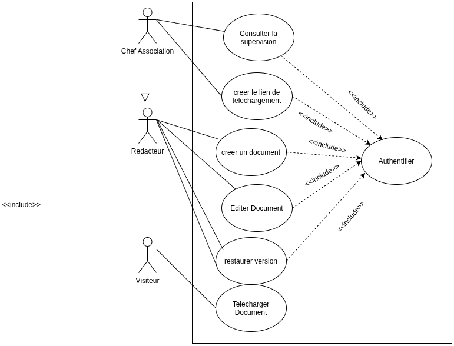
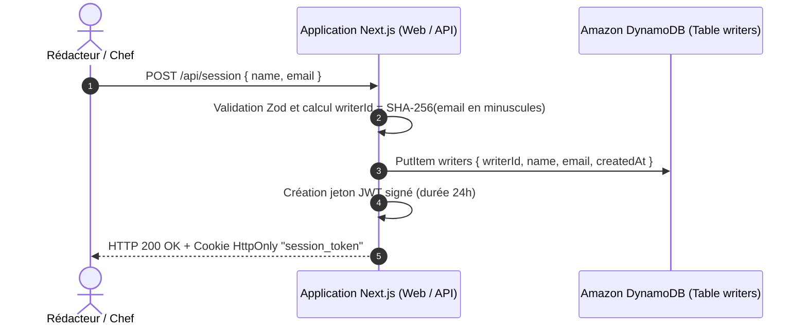
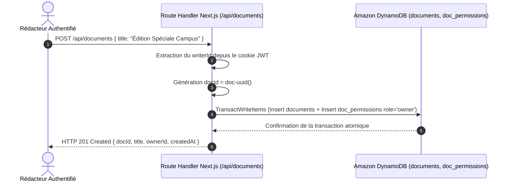
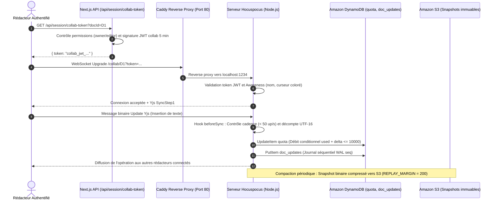
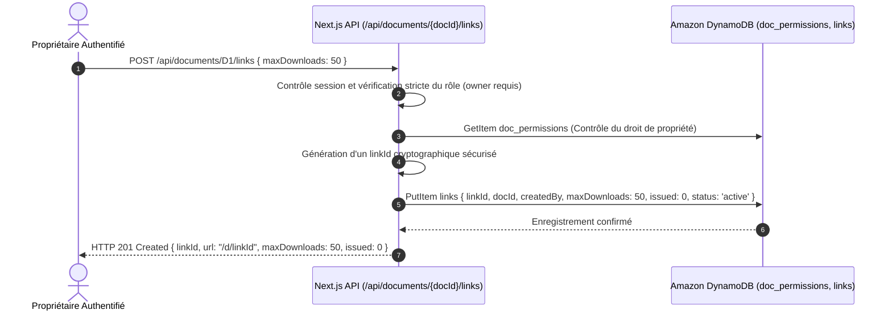
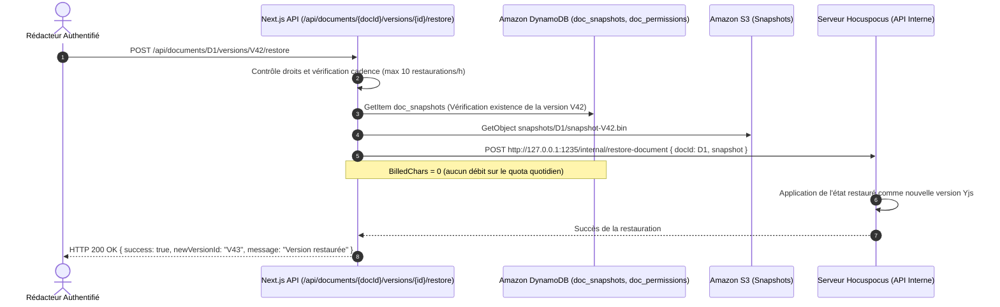
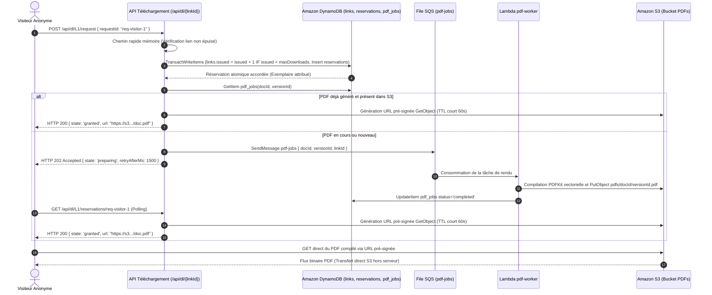
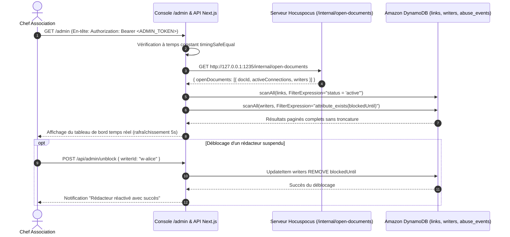

# Document de Conception Technique et d'Architecture (DESIGN.md)

Projet : **Éditeur de documents collaboratif avec téléchargement versionné sur AWS**  
Date : 25 octobre 2026 — Version 2.0.0

---

## Sommaire

1. [Vue d'Ensemble et Architecture Système](#1-vue-densemble-et-architecture-système)
2. [Modèle Fonctionnel et Cas d'Utilisation](#2-modèle-fonctionnel-et-cas-dutilisation)
   - 2.1 [Diagramme Général des Cas d'Utilisation](#21-diagramme-général-des-cas-dutilisation)
   - 2.2 [Diagrammes de Séquence des Cas d'Utilisation](#22-diagrammes-de-séquence-des-cas-dutilisation)
3. [Modèle de Données DynamoDB](#3-modèle-de-données-dynamodb)
4. [Modèle de Stockage Amazon S3](#4-modèle-de-stockage-amazon-s3)
5. [Preuves Formelles du Respect des Invariants](#5-preuves-formelles-du-respect-des-invariants)
6. [Limites Connues et Mesures d'Atténuation](#6-limites-connues-et-mesures-datténuation)
7. [Identité Visuelle et Charte Graphique](#7-identité-visuelle-et-charte-graphique)

---

## 1. Vue d'Ensemble et Architecture Système

Le système est conçu pour répondre aux exigences strictes de robustesse, de scalabilité et de sécurité définies dans le cahier des charges, sans avoir recours à des couches de complexité superflues (pas de cluster Kubernetes, pas de Redis, instance unique Hocuspocus).

### 1.1 Schéma d'Architecture Système AWS

<p align="center">
  
</p>

### 1.2 Description des Flux d'Architecture

- **Distribution et Entrée Edge** : Amazon CloudFront termine les connexions HTTPS et WebSockets en périphérie et achemine le trafic vers l'instance Amazon EC2 (via Caddy) et les points d'accès Serverless.
- **Instance EC2 Dédiée** : Héberge le reverse proxy Caddy (port 80/443), l'application Next.js 16 (port 3000) et le serveur collaboratif Hocuspocus (port 1234/1235).
- **Persistance Atomique** : Amazon DynamoDB stocke les métadonnées, les états de session, les verrous conditionnels, les quotas UTF-16 et le journal Write-Ahead Logging (WAL).
- **Stockage Objets Immuable** : Amazon S3 conserve les instantanés compactés Yjs et les fichiers PDF générés identifiés par le hachage SHA-256 de leur contenu textuel.
- **Traitement Asynchrone Découplé** : Une file Amazon SQS (`pdf-jobs`) alimente la fonction Lambda `pdf-worker`, garantissant l'isolation stricte du rendu PDF hors du chemin critique HTTP.
- **Supervision & Exploitation Sécurisée** : L'instance EC2 est gérée sans port SSH ouvert, exclusivement via AWS Systems Manager (SSM), et les métriques sont centralisées dans Amazon CloudWatch.

---

## 2. Modèle Fonctionnel et Cas d'Utilisation

### 2.1 Diagramme Général des Cas d'Utilisation

Le diagramme ci-dessous synthétise les cas d'utilisation du système pour chaque profil d'acteur identifié :

<p align="center">
  
</p>

#### Description des Acteurs
- **Chef Association** : Spécialisation du rédacteur (`Chef Association -|> Rédacteur`). Il hérite de l'ensemble des droits d'édition et dispose en plus du droit exclusif de consulter la supervision d'administration (`/admin`), de suivre les flux ouverts et de réactiver immédiatement les rédacteurs suspendus pour abus.
- **Rédacteur** : Membre de l'association étudiante. Il s'authentifie par son adresse e-mail, crée des documents textuels, rédige en collaboration temps réel avec affichage de présence, génère des liens de diffusion à tirage limité et restaure des versions antérieures.
- **Visiteur** : Lecteur externe anonyme. Il accède à un lien public de téléchargement sans compte ni authentification préalable pour obtenir un exemplaire PDF unique d'une édition.

---

### 2.2 Diagrammes de Séquence des Cas d'Utilisation

#### CU-01 : Authentifier (Inclus par toutes les actions de rédaction et de supervision)

Toutes les interactions privilégiées nécessitent l'inclusion du cas d'utilisation `Authentifier`. L'authentification repose sur un jeton JWT signé transmis via un cookie `HttpOnly` sécurisé.



---

#### CU-02 : Créer un Document



---

#### CU-03 : Éditer un Document (Collaboration Temps Réel, Présence & Quotas)

L'édition d'un document implique une négociation de jeton court (5 minutes), l'établissement d'une connexion WebSocket persistante, le contrôle continu du quota UTF-16 et la persistance séquentielle synchrone (Write-Ahead Logging).



---

#### CU-04 : Créer le Lien de Téléchargement (Propriétaire uniquement)



---

#### CU-05 : Restaurer une Version Antérieure

La restauration crée une nouvelle évolution du document sans écraser l'arbre historique postérieur et sans consommer le crédit quotidien de rédaction (`billedChars = 0`).



---

#### CU-06 : Télécharger un Document (Visiteur Anonyme)

Le visiteur anonyme accède au document sans compte. La réservation est atomique sous concurrence via DynamoDB, le rendu est isolé dans la Lambda `pdf-worker` via SQS, et le transfert s'effectue directement depuis S3 par URL pré-signée sans charge pour le serveur.



---

#### CU-07 : Consulter la Supervision (Chef Association)

Le chef de l'association supervise en temps réel les flux ouverts, les liens actifs et peut débloquer manuellement un rédacteur suspendu pour abus.



---

## 3. Modèle de Données DynamoDB

Toutes les tables utilisent le mode de facturation à la demande (`PAY_PER_REQUEST`). Les timestamps sont en millisecondes ou en ISO 8601 UTC.

| Nom de la table | Clé de partition (PK) | Clé de tri (SK) | Index secondaires (GSI) | TTL | Rôle métier |
| :--- | :--- | :--- | :--- | :---: | :--- |
| `writers` | `writerId` (S) | — | `by_email` (PK: `email`) | Non | Profils rédacteurs |
| `documents` | `docId` (S) | — | `by_owner` (PK: `ownerId`) | Non | Métadonnées documents |
| `doc_permissions` | `docId` (S) | `writerId` (S) | `by_writer` (PK: `writerId`, SK: `docId`) | Non | Droits d'accès (`owner`, `editor`, `viewer`) |
| `doc_updates` | `docId` (S) | `clock` (N) | — | 30 j | Journal d'updates Yjs (WAL) |
| `doc_snapshots` | `docId` (S) | `snapshotId` (S) | — | Non | Métadonnées des snapshots S3 |
| `doc_heads` | `docId` (S) | — | — | Non | Dernier versionId calculé |
| `quota` | `key` (S) | — | — | 2 j | Quota UTF-16 (`writerId#YYYY-MM-DD UTC`) & rate-limits |
| `abuse_events` | `writerId` (S) | `timestamp` (S) | — | 7 j | Historique des refus & détections de burst |
| `links` | `linkId` (S) | — | `by_doc` (PK: `docId`) | Non | Liens publics et compteurs (`issued`, `maxDownloads`) |
| `reservations` | `linkId` (S) | `reservationId` (S) | `by_request` (PK: `linkId`, SK: `requestId`) | 24 h | Réservations atomiques d'exemplaires |
| `pdf_jobs` | `docId` (S) | `versionId` (S) | — | Non | Suivi single-flight du rendu PDF |
| `notifications` | `notificationId` (S) | — | `by_status` (PK: `status`, SK: `scheduledAt`) | Non | Envois d'e-mails réessayables (F11) |

---

## 4. Modèle de Stockage Amazon S3

Le bucket est strictement privé (blocage public total, chiffrement SSE-S3 AES-256, rejet strict des connexions HTTP non-TLS).

### 4.1 Structure des Préfixes
- `texts/<docId>/<versionId>.txt` : Contenu textuel immuable UTF-8 exact correspondant à la version.
- `pdfs/<docId>/<versionId>.pdf` : Document PDF généré de façon déterministe avec en-tête et pagination.
- `snapshots/<docId>/<snapshotId>.bin` : Instantané compacté de l'état binaire du document Yjs (`Y.encodeStateAsUpdate`).

### 4.2 Identifiant de Version
La version d'un document est définie sans ambiguïté par :
$$\text{versionId} = \text{SHA-256}(\text{texte brut UTF-8})$$
Cette propriété garantit que deux rendus d'un même contenu textuel produisent le même identifiant de version et réutilisent le même artefact PDF sans recalcul.

---

## 5. Preuves Formelles du Respect des Invariants

### 5.1 Invariant C1 : Capacité et Concurrence de Téléchargement
> **Énoncé** : Pour un lien de $N$ exemplaires, il est strictement garanti que le nombre total d'URL pré-signées émises $E$ vérifie :
> $$0 \le E \le N$$
> Aucune condition de course, surcharge concurrente ou panne partielle ne peut entraîner $E > N$.

**Preuve & Implémentation** :
1. **Réservation Atomique** : Toute demande d'exemplaire passe obligatoirement par une transaction DynamoDB `TransactWriteItems` regroupant l'incrémentation conditionnelle de `issued` sur `links` (`issued < maxDownloads AND status = 'active'`) et la création de l'item réservation dans `reservations`.
2. **Idempotence stricte** : Si un même client retransmet son `requestId`, la requête est détectée via l'index GSI `by_request` et renvoie la réservation existante sans réincrémenter `issued`.
3. **Règle d'or de non-remboursement post-émission** : Une copie est considérée définitivement attribuée dès lors que l'URL pré-signée S3 a été communiquée au client. Aucun remboursement de copie n'a lieu après l'émission de l'URL.
4. **Chemin rapide mémoire** : Dès que `issued >= maxDownloads`, le lien est marqué saturé en mémoire vive locale (TTL 1 s). Les requêtes suivantes reçoivent un état `exhausted` immédiat sans consommer de capacité d'écriture DynamoDB.

### 5.2 Invariant C2 : Collaboration CRDT sans Perte de Modification
> **Énoncé** : Tous les collaborateurs connectés à un document convergent vers le même texte sans perte d'update acquitté.

**Preuve & Implémentation** :
1. **Write-Ahead Logging (WAL)** : Tout message d'édition reçu par le serveur Hocuspocus est persisté dans la table `doc_updates` (avec une séquence monotone incrémentale) **avant** d'être appliqué à l'état en mémoire vive et **avant** d'être diffusé aux pairs via WebSocket.
2. **Reprise après Crash** : En cas d'arrêt brutal du serveur Hocuspocus, le document est rechargé au prochain démarrage en lisant le dernier snapshot S3 puis en rejouant séquentiellement tous les updates du journal DynamoDB postérieurs à l'instantané (`REPLAY_MARGIN = 200`). L'état résultant est garanti identique à celui précédant le crash.

### 5.3 Invariant C3 : Immuabilité des Versions et Rendu PDF Single-Flight
> **Énoncé** : Un document PDF est rattaché à une version immuable. Le rendu d'une même version sous forte affluence n'est exécuté qu'une seule fois.

**Preuve & Implémentation** :
1. **Single-Flight Lock** : Lors d'une réservation, le processus vérifie dans `pdf_jobs` si un job est en cours. Seul le premier demandeur publie le message dans la file SQS `pdf-jobs`.
2. **Écriture Atomique S3** : Le worker PDF dépose le fichier avec l'en-tête `If-None-Match: *`. Si un worker concurrent a déjà écrit le fichier, S3 retourne HTTP 412 (Precondition Failed), interprété comme un succès immédiat.
3. **Gestion DLQ** : Si le rendu échoue après 3 tentatives, le message atterrit dans `pdf-jobs-dlq`. Le handler `pdf-dlq-handler` rembourse alors automatiquement la réservation en décrémentant atomiquement le compteur `issued` dans `links`.

### 5.4 Invariant C4 : Quota Journalier UTF-16 et Anti-Abus
> **Énoncé** : Un rédacteur ne peut insérer plus de 10 000 caractères UTF-16 par jour (remise à zéro à 00:00 UTC).

**Preuve & Implémentation** :
1. **Comptage Déterministe** : Les caractères insérés sont extraits des structs Yjs et comptés selon la métrique JavaScript `String.length` (unités de code UTF-16).
2. **Déduplication par IntervalSet** : Chaque transaction client est identifiée par `(clientID, clock, length)`. Si un client retransmet un update déjà reçu, le serveur détecte qu'aucun nouvel intervalle n'est couvert et facture 0 caractère.
3. **Débit Atomique** : Le débit est effectué via `UpdateItem` sur `quota` avec la clé `writerId#YYYY-MM-DD UTC` sous condition `usedChars + delta <= 10000`. En cas de dépassement, le message `write_refused` est envoyé et le client passe en lecture seule.

### 5.5 Sémantique de Notification du Dernier Exemplaire ("At-Least-Once")
> **Énoncé** : Lorsque le dernier exemplaire d'un lien est distribué (`issued == maxDownloads`), exactement un e-mail d'alerte est adressé au créateur du lien.
> Aucune notification en doublon n'est envoyée lors d'exécutions concurrentes du Notifier (DynamoDB Streams) et du Reconciler (EventBridge cron).

**Preuve & Implémentation** :
1. **Verrou Conditionnel d'Envoi** : L'envoi est centralisé dans la fonction `sendLastCopyNotification(linkId)` (`src/shared/notify/notifier.ts`). Avant tout appel à Amazon SES ou au serveur SMTP, un verrou atomique est réservé sur la table `notifications` :
   ```text
   UpdateItem Key: { linkId }
   UpdateExpression: SET #st = :sending, claimedAt = :now
   ConditionExpression: #st = :pending AND (attribute_not_exists(claimedAt) OR claimedAt < :staleCutoff)
   ```
   (où `staleCutoff = now - 120s`).
   Si la condition échoue, la fonction s'interrompt immédiatement avec la raison `already_claimed_or_sent`.
2. **Transition de Clôture** :
   - En cas de succès SES/SMTP : `SET #st = :sent, sentAt = :now REMOVE claimedAt, lastError`.
   - En cas d'échec SES/SMTP : `SET #st = :pending, attempts = attempts + 1, lastError = :err REMOVE claimedAt`. Si `attempts >= 5`, une alerte critique est émise et l'abandon est tracé.
3. **Scans Paginés Exhaustifs** : Tous les parcours de tables DynamoDB (`notifications`, `pdf_jobs`, `reservations`, `links`, `writers`) utilisent le helper `scanAll` bouclant systématiquement sur `LastEvaluatedKey`, éliminant toute troncature silencieuse au-delà de 1 Mo / 1000 items.

---

## 6. Limites Connues et Mesures d'Atténuation

Le système arbitre explicitement entre simplicité opérationnelle, maîtrise stricte du budget mensuel (< 10 $/mois) et garanties formelles. Les limites suivantes sont assumées et documentées :

1. **D-24 — Coalescence de version (`HEAD_COALESCE_MS = 1000`)** :
   - *Limite* : Sous un pic d'éditions continues, le calcul de la tête de document (`getHead`) met en cache la version pendant 1 000 ms pour éviter de recalculer un SHA-256 complet à chaque milliseconde. Deux téléchargements distants de 100 ms peuvent donc recevoir la même version de tête bien que de nouvelles frappes aient été reçues entre-temps.
   - *Atténuation* : Conforme à l'invariant C3 : chaque réservation fige une version exacte, immuable et cohérente à l'instant de la réservation. Aucun téléchargement n'est corrompu.

2. **D-15 — Risque de surfacturation et décompte par horloge `(clientId, clock)`** :
   - *Limite* : Si un client malveillant forge de nouveaux `clientId` artificiels à chaque frappe pour insérer des caractères, la déduplication par `IntervalSet` traite chaque paquet comme une nouvelle insertion.
   - *Atténuation* : Le quota quotidien de 10 000 caractères UTF-16 est rattaché à l'identité du rédacteur (`writerId` authentifié par session JWT HttpOnly), pas au `clientId` éphémère. Dès que le quota de 10 000 caractères du rédacteur est atteint, toute écriture est rejetée indépendamment du `clientId`. De plus, la détection de rafale (C-03) bloque l'émetteur après 5 infractions.

3. **URL pré-signée porteur de jeton pendant le TTL (D-04 / D-05)** :
   - *Limite* : Une URL pré-signée S3 délivrée à un visiteur est un jeton porteur (*bearer token*) pendant sa durée de vie (60 secondes) : le visiteur peut techniquement la partager ou la télécharger plusieurs fois avant expiration.
   - *Atténuation* : La durée de validité est fixée au minimum opérationnel (60 s). L'application n'émet strictement qu'une seule URL par réservation (`issued` ne s'incrémente qu'une fois) et refuse toute réémission après expiration (C-02).

4. **Sémantique de notification "au moins une fois" (SES)** :
   - *Limite* : Amazon SES ne fournit pas de primitive de déduplication "exactement-une-fois". Si le processus crash brutalement dans le laps de temps infinitésimal séparant l'envoi de l'e-mail par SES et la confirmation de l'écriture DynamoDB `status = "sent"`, le réconciliateur peut réexpédier un deuxième e-mail après expiration du verrou (120 s).
   - *Atténuation* : Le verrou conditionnel (`status = "pending"` + `claimedAt`) élimine 100 % des courses normales entre le stream Notifier et le cron Reconciler. Le cas résiduel de doublon n'intervient qu'en cas de crash matériel non maîtrisé.

5. **Scans DynamoDB périodiques du réconciliateur** :
   - *Limite* : Le réconciliateur parcourt les tables `notifications`, `pdf_jobs` et `reservations` toutes les 5 minutes via `scanAll`. Sur une base contenant des millions d'enregistrements, ces scans consommeraient une capacité de lecture excessive.
   - *Atténuation* : Adapté et dimensionné pour le volume de l'application (< 10 000 items). Les réservations disposent d'un TTL DynamoDB (24 h) nettoyant automatiquement les items expirés, et les scans sont paginés sans troncature.

6. **Point de défaillance unique (SPOF) de l'instance collab unique** :
   - *Limite* : Le serveur Hocuspocus tourne sur une seule instance EC2 (sans cluster multi-instances ni Redis Pub/Sub partagé, conformément à la décision D-02). Si l'instance EC2 tombe, la collaboration en temps réel est interrompue jusqu'au redémarrage du conteneur.
   - *Atténuation* : L'état persistant est entièrement sécurisé en amont (Write-Ahead Log dans DynamoDB et snapshots dans S3). Aucun travail n'est perdu lors d'un redémarrage : Hocuspocus recharge le snapshot et rejoue le journal DynamoDB à l'initialisation.

7. **Absence de pare-feu applicatif AWS WAF** :
   - *Limite* : Aucun Web Application Firewall n'est configuré devant CloudFront (frais fixes minimaux de 5 $/mois + 1 $/règle incompatibles avec le plafond budgétaire de 10 $).
   - *Atténuation* : La protection anti-abus est assurée au niveau applicatif (rate limiter 50 updates/s dans le serveur collab, détection d'abus, verrouillage mémoire 1s sur les liens épuisés, et validation Zod stricte sur chaque endpoint).

---

## 7. Identité Visuelle et Charte Graphique

### 7.1 Concept et Métaphore
Le logo de l'application **Éditeur Collaboratif** symbolise l'acte d'écriture partagée en temps réel destiné à la publication étudiante :
- **La feuille de papier** aux coins arrondis et coin replié en haut à droite évoque le support tangible, le manuscrit et le tirage papier / PDF final.
- **Les lignes de texte stylisées** représentent le contenu éditorial en cours d'élaboration.
- **Les deux curseurs collaboratifs colorés** (Indigo et Ambre), positionnés à des hauteurs différentes, illustrent la présence simultanée de plusieurs rédacteurs écrivant ensemble sur le même document.
- **Style géométrique plat (*flat design*)** : aucun artifice 3D, ni flou, ni filtre SVG lourd. L'identité repose sur des tracés vectoriels nets, épurés et directement lisibles à toutes les échelles (de 16 px à 512 px).

### 7.2 Palette Chromatique et Tokens CSS
Le symbole s'appuie sur la couleur d'accent principale de l'application (Indigo) combinée à une couleur secondaire chaleureuse (Ambre), intégrées sous forme de variables CSS dans les thèmes **Papier** (clair) et **Nuit** (sombre) :

| Rôle | Token CSS | Thème Papier (clair) | Thème Nuit (sombre) |
| :--- | :--- | :--- | :--- |
| **Fond de feuille** | `--color-brand-sheet-fill` | `#EEF2FF` (Indigo 50) | `#1E1B4B` (Indigo 950) |
| **Contour feuille** | `--color-brand-sheet-stroke` | `#4F46E5` (Indigo 600) | `#818CF8` (Indigo 400) |
| **Coin replié** | `--color-brand-fold-fill` | `#C7D2FE` (Indigo 200) | `#312E81` (Indigo 900) |
| **Lignes de texte** | `--color-brand-lines` | `#94A3B8` (Slate 400) | `#475569` (Slate 600) |
| **Curseur Rédacteur 1** | `--color-brand-cur1` | `#4F46E5` (Indigo 600) | `#818CF8` (Indigo 400) |
| **Curseur Rédacteur 2** | `--color-brand-cur2` | `#F59E0B` (Amber 500) | `#FBBF24` (Amber 400) |
| **Monochrome** | *Mode mono* | `currentColor` | `currentColor` |

### 7.3 Mot-Symbole (Typographie)
Conformément aux règles de conception, le nom de l'application n'est **jamais encodé dans le fichier SVG**, afin de garantir une accessibilité optimale et une netteté vectorielle native :
- Rendu en **texte HTML** utilisant la police de l'interface (**Geist Sans**).
- Hiérarchie typographique : « **Éditeur** » en graisse grasse (`font-bold text-slate-900 dark:text-white`), suivi de « **Collaboratif** » en graisse normale (`font-normal text-slate-600 dark:text-slate-300`).
- Sur les écrans mobiles étroits (< 640 px), l'option `hideTextOnMobile` permet de masquer le texte pour ne conserver que le symbole vectoriel dans la barre d'en-tête.

### 7.4 Zone de Protection et Tailles Minimales
- **Zone de protection (marge de sécurité)** :
  Une zone d'exclusion minimale égale à **25 % de la largeur du symbole** (`0.25 × size`) doit être respectée tout autour du logo. Aucun texte, bouton ou séparateur ne doit empiéter sur cet espace.
- **Taille minimale à l'écran** :
  - **16 × 16 px** : taille minimale d'affichage (favicon navigateur, barre de statut).
  - **24 × 24 px** : taille recommandée pour les barres d'outils et menus contextuels.
  - **32 × 32 px** : taille standard des en-têtes d'application.
  - **64 × 64 px / 128 × 128 px** : variantes empilées pour écrans de connexion et modales.
- **Taille minimale en impression / PDF** : 5 mm de côté.

### 7.5 Usages Interdits
Pour préserver l'intégrité de l'identité de marque, les pratiques suivantes sont formellement proscrites :
1. **Déformation** : Ne jamais étirer, compresser ou incliner le logo (respecter impérativement le ratio 1:1).
2. **Recoloration arbitraire** : Ne pas substituer les teintes Indigo et Ambre par des couleurs fantaisistes hors de la palette de marque (utiliser `mono={true}` / `currentColor` si une intégration uniforme est nécessaire).
3. **Ajout d'effets visuels** : Ne pas ajouter d'ombres portées agressives, biseaux 3D, flous gaussiens ou dégradés complexes non validés.
4. **Contraste insuffisant** : Ne jamais placer le logo couleur sur un fond de teinte proche (respecter systématiquement le ratio de contraste minimal de 4.5:1 WCAG AA).
5. **Texte dans le SVG** : Ne pas intégrer le nom du produit en balises `<text>` dans le SVG de marque.
6. **Emojis et glyphes bruts** : Ne jamais substituer le logo ou les icônes d'action par des emojis système ou des caractères Unicode non vectoriels.
