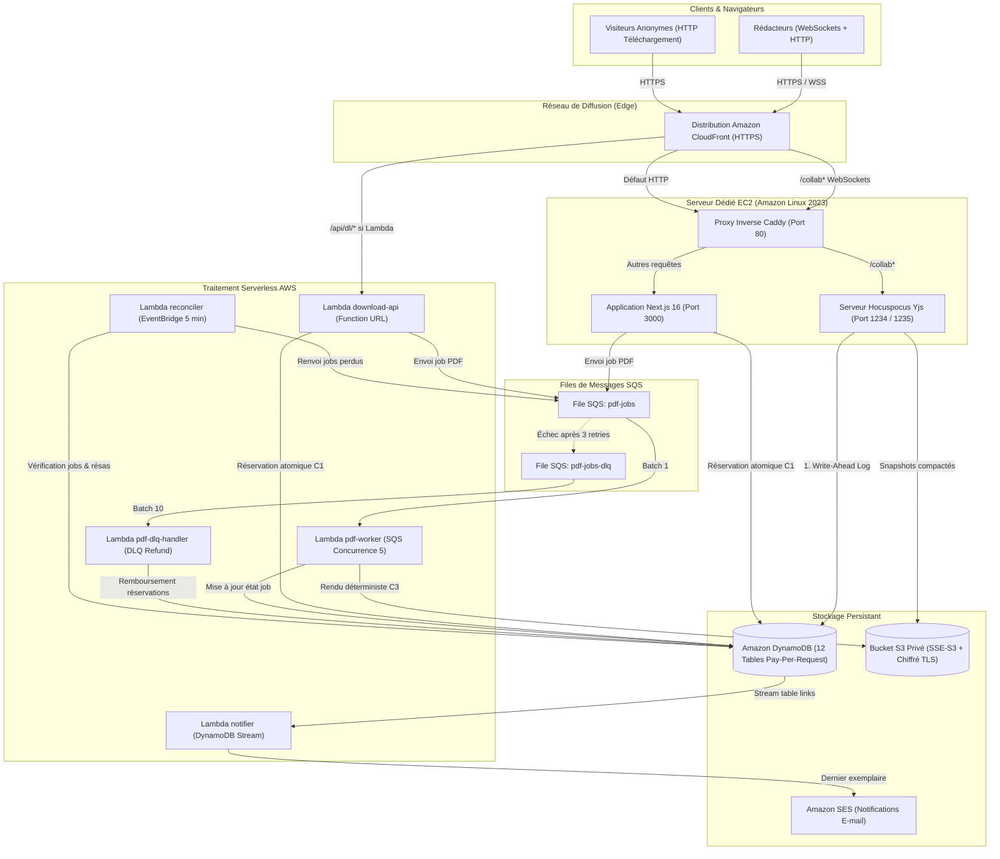

# Document de Conception Technique et d'Architecture (DESIGN.md)

Projet : **Éditeur de documents collaboratif avec téléchargement versionné sur AWS**  
Date : 24 octobre 2026 — Version 1.0.0

---

## 1. Vue d'Ensemble et Architecture Système

Le système est conçu pour répondre aux exigences strictes de robustesse, de scalabilité et de sécurité définies dans le cahier des charges, sans avoir recours à des couches de complexité superflues (pas de Kubernetes, pas de Redis, instance unique Hocuspocus).

### 1.1 Diagramme d'Architecture Globale (Mermaid)



---

## 2. Modèle de Données DynamoDB

Toutes les tables utilisent le mode de facturation à la demande (`PAY_PER_REQUEST`). Les timestamps sont en millisecondes ou en ISO 8601 UTC.

| Nom de la table | Clé de partition (PK) | Clé de tri (SK) | Index secondaires (GSI) | TTL | Rôle métier |
| :--- | :--- | :--- | :--- | :---: | :--- |
| `writers` | `writerId` (S) | — | `by_email` (PK: `email`) | Non | Profils rédacteurs |
| `documents` | `docId` (S) | — | `by_owner` (PK: `ownerId`) | Non | Métadonnées documents |
| `doc_permissions` | `docId` (S) | `writerId` (S) | `by_writer` (PK: `writerId`, SK: `docId`) | Non | Droits d'accès (`owner`, `editor`, `viewer`) |
| `doc_updates` | `docId` (S) | `clock` (N) | — | 30 j | Journal d'updates Yjs (WAL) |
| `doc_snapshots` | `docId` (S) | `snapshotId` (S) | — | Non | Métadonnées des snapshots S3 |
| `doc_heads` | `docId` (S) | — | — | Non | Dernier versionId calculé |
| `quota` | `key` (S) | — | — | 2 j | Quota UTF-16 (`writerId#YYYY-MM-DD UTC`) & rate-limits |
| `abuse_events` | `writerId` (S) | `timestamp` (S) | — | 7 j | Historique des refus & détections de burst |
| `links` | `linkId` (S) | — | `by_doc` (PK: `docId`) | Non | Liens publics et compteurs (`issued`, `maxDownloads`) |
| `reservations` | `linkId` (S) | `reservationId` (S) | `by_request` (PK: `linkId`, SK: `requestId`) | 24 h | Réservations atomiques d'exemplaires |
| `pdf_jobs` | `docId` (S) | `versionId` (S) | — | Non | Suivi single-flight du rendu PDF |
| `notifications` | `notificationId` (S) | — | `by_status` (PK: `status`, SK: `scheduledAt`) | Non | Envois d'e-mails réessayables (F05) |

---

## 3. Modèle de Stockage Amazon S3

Le bucket est strictement privé (blocage public total, chiffrement SSE-S3 AES-256, rejet strict des connexions HTTP non-TLS).

### 3.1 Structure des Préfixes
- `texts/<docId>/<versionId>.txt` : Contenu textuel immuable UTF-8 exact correspondant à la version.
- `pdfs/<docId>/<versionId>.pdf` : Document PDF généré de façon déterministe avec en-tête et pagination.
- `snapshots/<docId>/<snapshotId>.bin` : Instantané compacté de l'état binaire du document Yjs (`Y.encodeStateAsUpdate`).

### 3.2 Identifiant de Version
La version d'un document est définie sans ambiguïté par :
$$\text{versionId} = \text{SHA-256}(\text{texte brut UTF-8})$$
Cette propriété garantit que deux rendus d'un même contenu textuel produisent le même identifiant de version et réutilisent le même artefact PDF sans recalcul.

---

## 4. Preuves Formelles du Respect des Invariants

### 4.1 Invariant C1 : Capacité et Concurrence de Téléchargement
> **Énoncé** : Pour un lien de $N$ exemplaires, il est strictement garanti que le nombre total d'URL pré-signées émises $E$ vérifie :
> $$0 \le E \le N$$
> Aucune condition de course, surcharge concurrente ou panne partielle ne peut entraîner $E > N$.

**Preuve & Implémentation** :
1. **Réservation Atomique** : Toute demande d'exemplaire passe obligatoirement par une transaction DynamoDB `TransactWriteItems` regroupant :
   - L'incrémentation conditionnelle de `issued` sur la table `links` :
     ```text
     Condition: attribute_exists(linkId) AND #st = 'active' AND #iss < #max
     Update: SET #iss = #iss + 1
     ```
   - La création de l'item réservation dans la table `reservations` sous condition d'inexistence :
     ```text
     Condition: attribute_not_exists(reservationId)
     ```
2. **Idempotence stricte** : Si un même client retransmet son `requestId`, la requête est détectée via l'index GSI `by_request` et renvoie la réservation existante sans incrémenter `issued`.
3. **Règle d'or de non-remboursement post-émission** : Une copie est considérée définitivement attribuée dès lors que l'URL pré-signée S3 a été communiquée au client. Aucun remboursement de copie n'a lieu après l'émission de l'URL.
4. **Chemin rapide mémoire** : Dès que `issued >= maxDownloads`, le lien est marqué saturé en mémoire vive locale (TTL 1 s). Les requêtes suivantes reçoivent un état `exhausted` immédiat sans consommer de capacité d'écriture DynamoDB.

### 4.2 Invariant C2 : Collaboration CRDT sans Perte de Modification
> **Énoncé** : Tous les collaborateurs connectés à un document convergent vers le même texte sans perte d'update acquitté.

**Preuve & Implémentation** :
1. **Write-Ahead Logging (WAL)** : Tout message d'édition reçu par le serveur Hocuspocus est persisté dans la table `doc_updates` (avec une horloge logique incrémentale) **avant** d'être appliqué à l'état en mémoire vive et **avant** d'être diffusé aux pairs via WebSocket.
2. **Reprise après Crash** : En cas d'arrêt brutal du serveur Hocuspocus, le document est rechargé au prochain démarrage en lisant le dernier snapshot S3 puis en rejouant séquentiellement tous les updates du journal DynamoDB postérieurs à l'instantané. L'état résultant est garanti identique à celui précédant le crash.

### 4.3 Invariant C3 : Immuabilité des Versions et Rendu PDF Single-Flight
> **Énoncé** : Un document PDF est rattaché à une version immuable. Le rendu d'une même version sous forte affluence n'est exécuté qu'une seule fois.

**Preuve & Implémentation** :
1. **Single-Flight Lock** : Lors d'une réservation, le processus tente d'insérer un enregistrement dans `pdf_jobs` avec la condition `attribute_not_exists(docId)`. Seul le gagnant publie le message dans la file SQS `pdf-jobs`.
2. **Écriture Atomique S3** : Le worker PDF dépose le fichier avec l'en-tête `If-None-Match: *`. Si un worker concurrent a déjà écrit le fichier, S3 retourne HTTP 412 (Precondition Failed), interprété comme un succès immédiat.
3. **Gestion DLQ** : Si le rendu échoue après 3 tentatives, le message atterrit dans `pdf-jobs-dlq`. Le handler `pdf-dlq-handler` rembourse alors automatiquement la réservation en décrémentant atomiquement le compteur `issued` dans `links`.

### 4.4 Invariant C4 : Quota Journalier UTF-16 et Anti-Abus
> **Énoncé** : Un rédacteur ne peut insérer plus de 10 000 caractères UTF-16 par jour (remise à zéro à 00:00 UTC).

**Preuve & Implémentation** :
1. **Comptage Déterministe** : Les caractères insérés sont extraits des structs Yjs et comptés selon la métrique JavaScript `String.length` (unités de code UTF-16).
2. **Déduplication par IntervalSet** : Chaque transaction client est identifiée par `(clientID, clock, length)`. Si un client retransmet un update déjà reçu, le serveur détecte qu'aucun nouvel intervalle n'est couvert et facture 0 caractère.
3. **Débit Atomique** : Le débit est effectué via `UpdateItem` sur `quota` avec la clé `writerId#YYYY-MM-DD UTC` sous condition `usedChars + delta <= 10000`. En cas de dépassement, le message `write_refused` est envoyé et le client passe en lecture seule.

---

## 5. Limites Connues et Mesures d'Atténuation

1. **Jeton porteur de l'URL pré-signée** :
   - *Limite* : Une URL pré-signée S3 peut techniquement être partagée entre plusieurs personnes pendant sa durée de vie.
   - *Atténuation* : La durée de validité est restreinte au minimum opérationnel strict (60 secondes par défaut).
2. **Fenêtre de coalescence de version (HEAD_COALESCE_MS)** :
   - *Limite* : Sous fort pic de frappe, deux téléchargements distants de quelques millisecondes peuvent recevoir deux versions consécutives très proches.
   - *Atténuation* : Ce comportement respecte l'invariant C3 car chaque version est immuable et exacte à l'instant de la réservation.
3. **Mode Sandbox SES sur compte AWS neuf** :
   - *Limite* : Seuls les e-mails validés peuvent recevoir les alertes de saturation du dernier exemplaire.
   - *Atténuation* : Variable Terraform `ses_recipients` dédiée pour pré-enregistrer les adresses de test.
